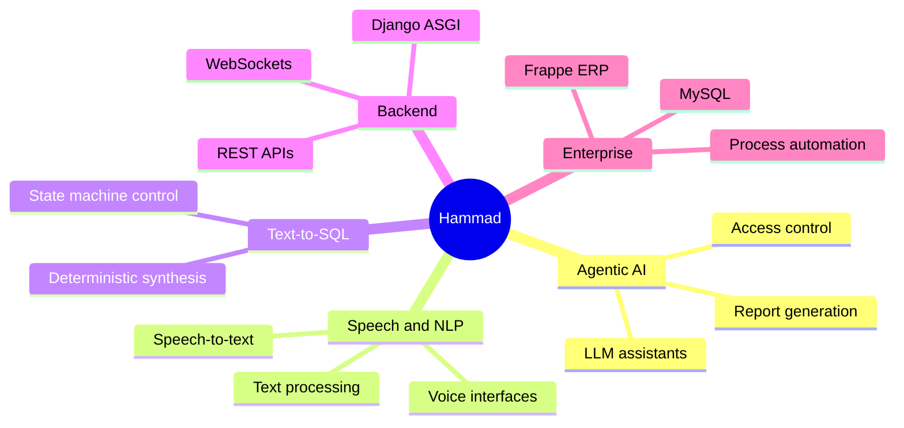
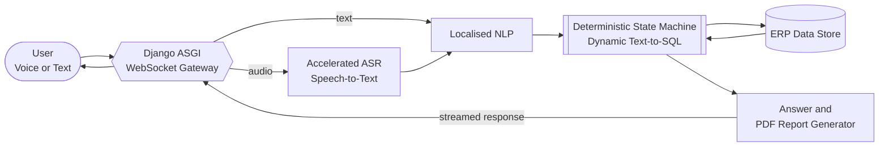
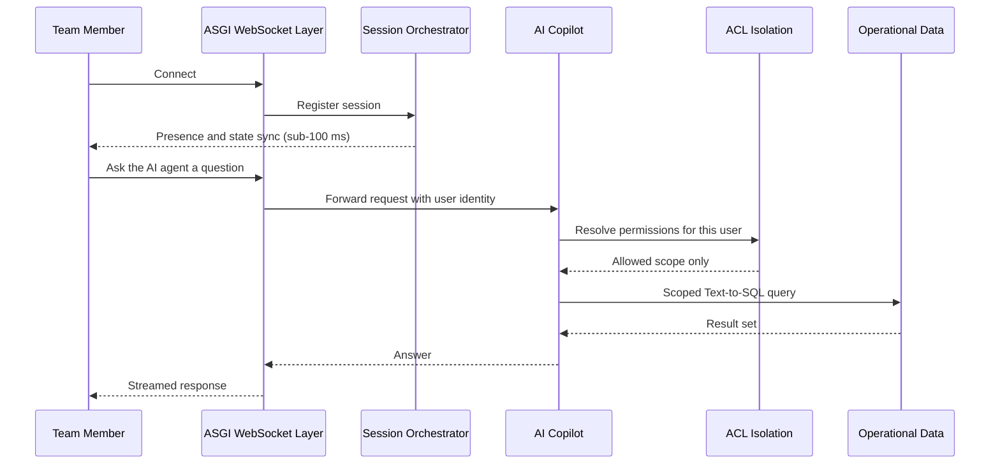
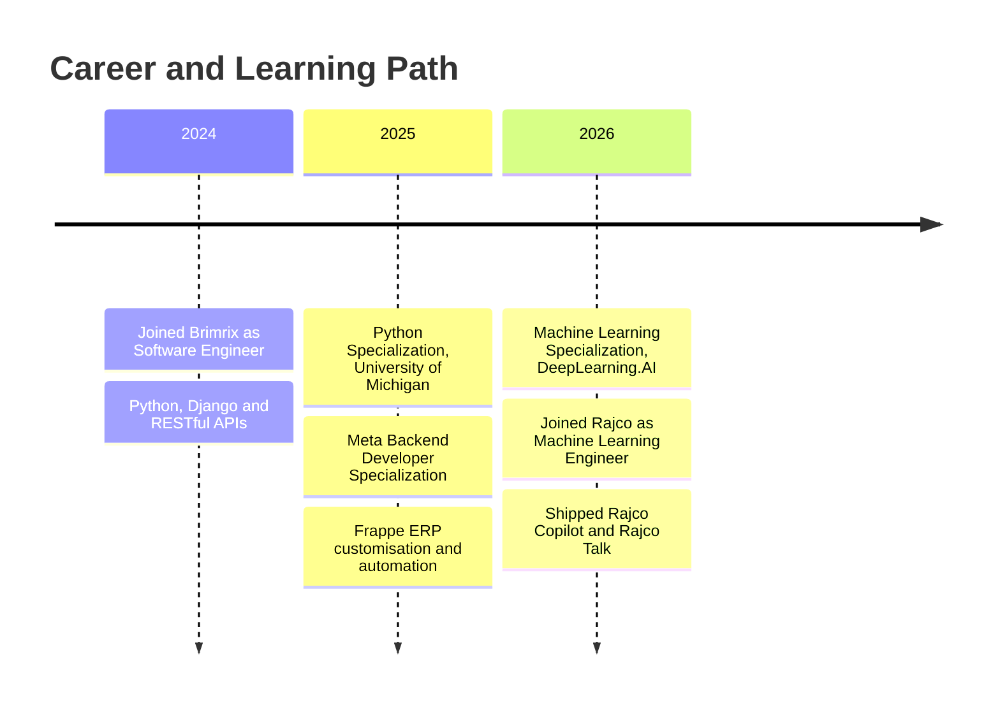

<!-- ============================== HEADER ============================== -->
<div align="center">


<a href="https://github.com/Hammad-5705">
  
</a>

<br/>

[](https://www.linkedin.com/in/hammad5705/)
[](mailto:hamadnad2014@gmail.com)
[](https://hammad-5705.github.io/Portfolio/)
[](https://github.com/Hammad-5705)

</div>

---

## 👨‍💻 About Me

I am a **Machine Learning Engineer with 2+ years of experience** building production software in Python and Django. My current work focuses on **agentic AI systems for industrial environments**: voice- and text-driven assistants that connect natural language to real operational data, with strict attention to **latency, reliability and access control**.

I combine backend engineering, real-time systems and applied machine learning, and I am looking for an engineering role in **Germany** where I can build dependable AI-enabled software.

```js
const hammad = {
  role:      "Machine Learning Engineer — Agentic AI & Backend",
  currently: "Machine Learning Engineer @ Rajco",
  previously: "Software Engineer @ Brimrix",
  location:  "Pakistan 🇵🇰",
  education: "BS Software Engineering — Virtual University of Pakistan (in progress)",
  focus:     ["Agentic AI", "Speech & NLP", "Text-to-SQL", "Real-time Backends"],
  certified: ["Meta", "DeepLearning.AI", "University of Michigan"],
  openTo:    ["Relocation to Germany 🇩🇪", "ML engineering roles", "AI-enabled backend development"],
};
```

---

## 📊 At a Glance

| 🚀 **2+ Years**                  | ⚡ **Sub-100 ms**                           | 🎓 **3**                         | 🇩🇪 **Germany**         |
| ------------------------------- | ------------------------------------------ | ------------------------------- | ---------------------- |
| Python backend & AI engineering | Real-time state sync in production         | Professional certifications     | Available to relocate  |

---

## 🧰 Technology Stack

**Languages & Core**

[](https://github.com/Hammad-5705)

**AI & Machine Learning**

[](https://github.com/Hammad-5705)

**Frontend & Tools**

[](https://github.com/Hammad-5705)

<details>
<summary><b>📚 Full competency overview</b></summary>

<br/>

| Domain                | Expertise                                                                    |
| --------------------- | ---------------------------------------------------------------------------- |
| **Languages**         | Python, SQL, C/C++, Assembly                                                 |
| **AI & ML**           | Agentic LLM Systems, NLP, ASR (Speech-to-Text), Text-to-SQL, TensorFlow, scikit-learn, Pandas, NumPy |
| **Backend & Systems** | Django (ASGI), WebSockets, REST APIs, Frappe, MySQL                          |
| **Frontend & Tools**  | HTML, CSS, Tailwind CSS, Bootstrap, Jinja2, Git / GitHub, Linux              |

</details>

### 🗺️ Skills Map



---

## 🚀 Featured Projects

### 🧠 Rajco Copilot — Agentic Assistant for Enterprise ERP Data

> An agentic assistant built from first principles. Users ask questions by **voice or text** and receive answers and **PDF reports** drawn from live factory data.

`Python` `Django ASGI` `WebSockets` `ASR` `NLP` `Text-to-SQL`

- Localised NLP and **accelerated ASR pipelines** for hands-free interaction with factory systems.
- A **deterministic state machine** drives dynamic Text-to-SQL synthesis instead of free-form query generation.
- A real-time **Django ASGI streaming engine** with bidirectional WebSockets delivers responses as they are produced.



[](https://copilot.rajcoapps.top/)

---

### 💬 Rajco Talk — Real-Time Enterprise Communication Platform

> Backend and AI infrastructure for a platform covering **messaging, voice and video calling, and a live AI agent**.

`Django ASGI` `WebSockets` `Real-time Sync` `ACL Isolation` `Text-to-SQL`

- **Sub-100 ms** real-time state synchronisation across connected clients.
- WebSocket **session orchestration** for messaging and calling.
- An agentic copilot with **strict ACL runtime isolation** and Text-to-SQL capabilities.



[](https://www.rajcotalk.tech/)

> 🔒 *Both projects were built in a professional setting as part of a team, so their source code is not public. I am happy to discuss architecture and design decisions in an interview.*
>
> *Diagrams show the conceptual architecture, not internal implementation details.*

---

## 💼 Professional Experience

| **06/2026 — Present** | **Machine Learning Engineer** · *Rajco*<br>Designed and deployed an agentic copilot that processes voice and text input and automates factory data ingestion, analysis and report generation.<br>Built data pipelines for manufacturing metrics, reducing manual reporting effort and providing real-time operational insight.<br>Integrated speech-to-text for hands-free interaction with factory management systems.<br>Developed an organisation-wide internal communication application to replace mobile phone use and improve compliance. |
| --------------------- | ------------------------------------------------------------------------------------------------------------------------------------------------------------------------------------------------------------------------------------------------------------------------------------------------------------------------------------------------------------------------------------------------------------------------------------------------------------------------------------------------------------------------------------------------ |
| **08/2024 — 06/2026** | **Software Engineer** · *Brimrix*<br>Developed and maintained web applications using Python and Django.<br>Customised and extended ERP functionality with the Frappe framework and automated ERP processes.<br>Designed, implemented and tested RESTful APIs for front-end applications.                                                                                                                                                                                                                                                         |

### 🕰️ Career & Learning Timeline



---

## 🎓 Education & Certifications

| Year            | Qualification                             | Institution                    |
| --------------- | ----------------------------------------- | ------------------------------ |
| In progress     | **BS Software Engineering**               | Virtual University of Pakistan |
| 2026            | **Machine Learning Specialization**       | DeepLearning.AI                |
| 06/2025         | **Meta Backend Developer Specialization** | Meta                           |
| 02/2025         | **Python Specialization**                 | University of Michigan         |

---

## 🌱 Open Source & Exploration

Repositories I have forked to study and experiment with in the AI-agent and Django space:

| Repository | Focus |
| ---------- | ----- |
| [OpenHands](https://github.com/Hammad-5705/OpenHands) | AI-driven development |
| [verity-codeproof](https://github.com/Hammad-5705/verity-codeproof) | An independent agent that verifies whether AI-generated code actually works |
| [django-ai-assistant](https://github.com/Hammad-5705/django-ai-assistant) | Integrating AI assistants with Django applications |

---

## 🎯 Engineering Principles

- **Reliability first** — deterministic state machines over unconstrained generation where correctness matters.
- **Latency by design** — real-time systems measured in milliseconds, not seconds.
- **Access control as a default** — strict permission isolation for every AI-driven query.
- **Production mindset** — built for real operational environments, not just demos.

---

## 🇩🇪 Availability

I am based in Pakistan and **available to relocate to Germany**. I am interested in roles in **machine learning engineering, AI-enabled backend development and industrial software**.

---

## 🤝 Let's Connect

I welcome conversations about agentic AI, real-time backend systems and industrial software. If you are hiring in Germany or want to collaborate, feel free to reach out.

[](https://www.linkedin.com/in/hammad5705/)
[](mailto:hamadnad2014@gmail.com)
[](https://hammad-5705.github.io/Portfolio/)

<div align="center">

*"Building dependable AI, one pipeline at a time."*


</div>
