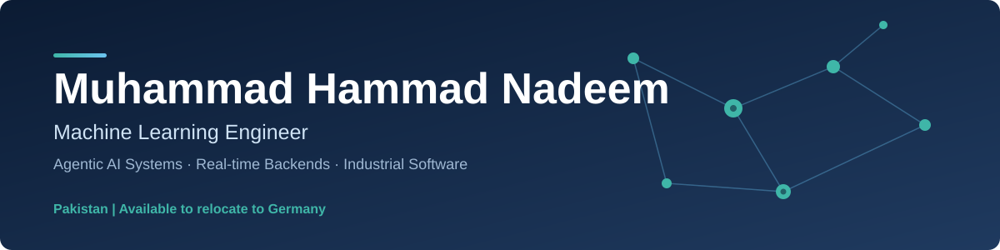
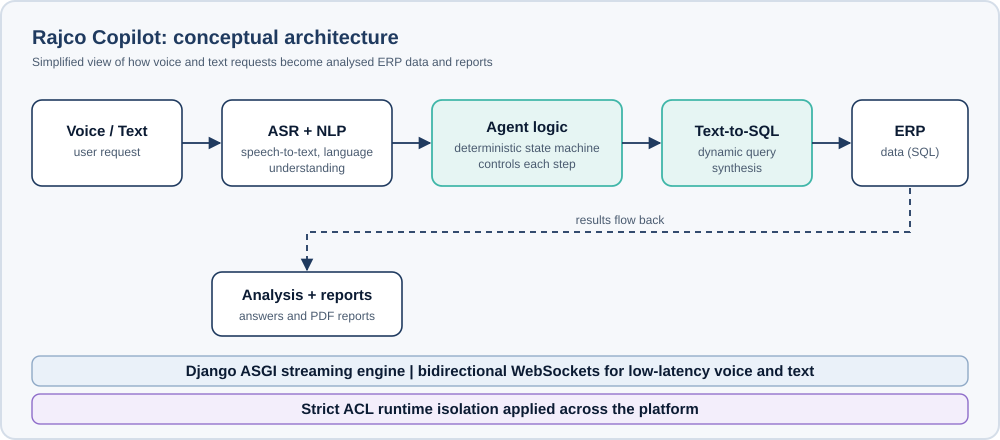

 

[About](#about) &nbsp;|&nbsp; [Experience](#professional-experience) &nbsp;|&nbsp; [Selected Work](#selected-work) &nbsp;|&nbsp; [Skills](#technical-skills) &nbsp;|&nbsp; [Education](#education-and-certifications) &nbsp;|&nbsp; [Contact](#contact)
<!-- To show a portfolio link here later, add after "Contact":  &nbsp;|&nbsp; [Portfolio](https://YOUR-PORTFOLIO-URL) -->

---

## At a Glance

| 2+ years | Sub-100 ms | 3 | Germany |
| :---: | :---: | :---: | :---: |
| professional experience in Python backend and AI engineering | real-time state synchronisation in a production communication platform | professional certifications in machine learning and backend development | available to relocate |

---

## About

I am a Machine Learning Engineer with over two years of professional experience building production software in Python and Django. My current work focuses on agentic AI systems for industrial environments: voice- and text-driven assistants that connect natural language to real operational data, with strict attention to latency, reliability and access control.

I combine backend engineering, real-time systems and applied machine learning, and I am looking for an engineering role in Germany where I can build dependable AI-enabled software.

## Focus Areas

| Area | What I build |
| --- | --- |
| **Agentic AI systems** | Language-model-driven assistants for data analysis and report generation |
| **Speech and NLP** | Speech-to-text pipelines, text processing and voice-activated interfaces |
| **Text-to-SQL** | Deterministic, state-machine-controlled query synthesis |
| **Real-time backends** | Django ASGI, WebSockets and low-latency state synchronisation |
| **Enterprise systems** | ERP customisation and automation, REST API design |

## Professional Experience

| Period | Role and achievements |
| --- | --- |
| **06/2026 to present** | **Machine Learning Engineer, Rajco** Designed and deployed an agentic copilot that processes voice and text input and automates factory data ingestion, analysis and report generation. Built data pipelines for manufacturing metrics, reducing manual reporting effort and providing real-time operational insight. Integrated speech-to-text for hands-free interaction with factory management systems. Developed an organisation-wide internal communication application to replace mobile phone use and improve compliance. |
| **08/2024 to 06/2026** | **Software Engineer, Brimrix** Developed and maintained web applications using Python and Django. Customised and extended ERP functionality with the Frappe framework and automated ERP processes. Designed, implemented and tested RESTful APIs for front-end applications. |

## Selected Work

### Rajco Copilot

An agentic assistant for enterprise ERP data, built from first principles. Users ask questions by voice or text and receive answers and PDF reports. It uses localised NLP, accelerated ASR pipelines, a deterministic state machine for dynamic Text-to-SQL synthesis, and a real-time Django ASGI streaming engine with bidirectional WebSockets.

### Rajco Talk

Backend and AI infrastructure for an enterprise real-time communication platform covering messaging, voice and video calling, and a live AI agent. My contribution includes sub-100 ms real-time state synchronisation, WebSocket session orchestration, and an agentic copilot with strict ACL runtime isolation and Text-to-SQL capabilities.

> Both projects were built in a professional setting as part of a team, so their source code is not public. I am happy to discuss architecture and design decisions in an interview.

## Technical Skills

  
   
  

| Area | Technologies |
| --- | --- |
| Languages | Python, SQL, C/C++, Assembly |
| AI / ML | Agentic LLM systems, NLP, ASR (speech-to-text), Text-to-SQL, TensorFlow, scikit-learn, Pandas, NumPy |
| Backend & Systems | Django (ASGI), WebSockets, REST APIs, Frappe, MySQL |
| Frontend & Tools | HTML, CSS, Tailwind CSS, Bootstrap, Jinja2, Git / GitHub, Linux |

## Education and Certifications

| Year | Qualification | Institution |
| --- | --- | --- |
| In progress | **BS Software Engineering** | Virtual University of Pakistan |
| 2026 | **Machine Learning Specialization** | DeepLearning.AI |
| 06/2025 | **Meta Backend Developer Specialization** | Meta |
| 02/2025 | **Python Specialization** | University of Michigan |

## Availability

I am based in Pakistan and available to relocate to Germany. I am interested in roles in machine learning engineering, AI-enabled backend development and industrial software.

## Contact

<!-- PORTFOLIO LINK (add later). Steps: (1) delete the next comment's opening and closing markers so the badge line shows, (2) replace YOUR-PORTFOLIO-URL with your real address, for example https://yourname.dev, (3) optionally do the same for the Portfolio link in the navigation row at the top of this file. -->
<!--  -->
